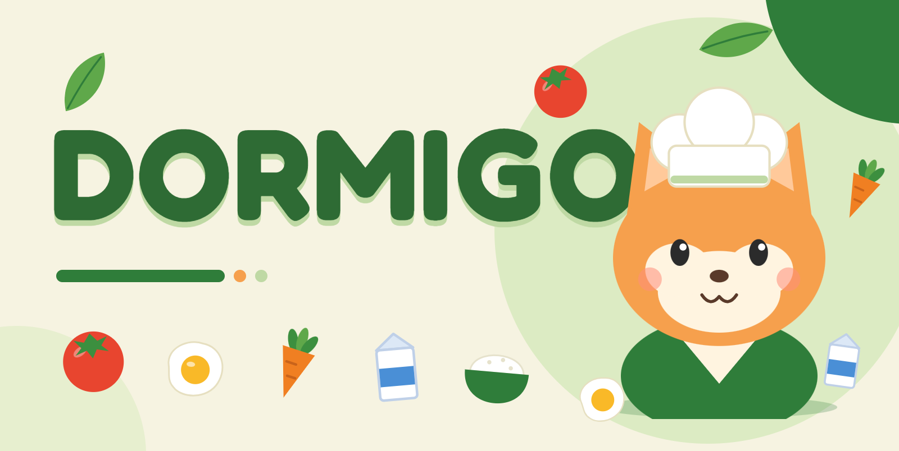

<h1 align="center"> DORMIGO</h1>
<h3 align="center">A Smart Pantry and Recipe Recommendation Mobile Application for Dormitory Students</h3>

> A smart mobile application that helps dormitory students manage food inventory, track expiration dates, and discover AI-powered recipes based on available ingredients and cooking equipment — promoting efficient food management, smarter meal planning, and reduced food waste.

<div align="center">


</div>



<br>

---

## 📑 Table of Contents
1. [Getting Started](#getting-started)
2. [Project Overview](#project-overview)
3. [Project Objectives](#project-objectives)
4. [Technology Stack](#tech-stack)
5. [AI Integration](#ai-integration)
6. [Installation and Setup](#installation-and-setup)
7. [Project Scope and Limitations](#project-scope-and-limitations)
8. [UML Diagram](#uml-diagram)
9. [Future Enhancements](#future-enhancements)
10. [Developers](#developers)
11. [License](#license)
12. [Acknowledgements](#acknowledgements)

---

<br>

## Getting Started

This project is a starting point for a Flutter application.

A few resources to get you started if this is your first Flutter project:

- [Learn Flutter](https://docs.flutter.dev/get-started/learn-flutter)
- [Write your first Flutter app](https://docs.flutter.dev/get-started/codelab)
- [Flutter learning resources](https://docs.flutter.dev/reference/learning-resources)

For help getting started with Flutter development, view the
[online documentation](https://docs.flutter.dev/), which offers tutorials,
samples, guidance on mobile development, and a full API reference.

<br>

---

## Project Overview

DORMIGO is a Flutter-based mobile application developed using the Dart programming language and AI integration. It was designed to address the challenges faced by dormitory students in managing their food supplies due to limited storage, busy academic schedules, and restricted cooking equipment.

Many students living in dormitories and boarding houses struggle to keep track of their available ingredients, expiration dates, and food consumption. Without an organized inventory system, ingredients may be forgotten, expiration dates may be overlooked, and unnecessary food purchases may contribute to food waste. Additionally, students may find it difficult to prepare meals using the ingredients and cooking appliances available to them.

DORMIGO aims to provide a centralized digital platform where users can record and manage their food inventory through photo uploads or manual entry. It also monitors food quantities and expiration dates to help users identify ingredients that should be consumed first.

Through AI-powered food identification and recipe recommendations, the application helps users discover practical meals based on their available ingredients and dormitory cooking equipment.

The system covers the main processes of food management: from adding ingredients to a digital pantry and monitoring expiration dates, to discovering suitable recipes, following cooking instructions, and tracking food consumption.

🎯 Target Users
- **Dormitory Students** – Students looking for a convenient way to organize food supplies and discover practical meals.
- **College Students** – Students who have limited time, budgets, storage space, and access to cooking appliances.
- **Students in Shared** Accommodations – Individuals who want to monitor available ingredients and minimize unnecessary food purchases.
- **Future Developers** – Developers and students who may maintain, improve, or extend the application's functionalities.

<br>

---

## Project Objectives

**General Objectives**

To develop a Flutter-based mobile application using Dart and AI integration that helps dormitory students manage food inventory, discover practical recipes, monitor food consumption, and minimize food waste.

**Specific Objectives**

Specifically, the project aims to:
- Develop a Smart Digital Pantry that allows users to add, organize, and manage food items through photo uploads, camera capture, or manual entry, with AI-assisted food identification.
- Implement an Expiry Date Tracker that monitors food quantities and expiration dates while highlighting ingredients that should be consumed first.
- Integrate AI-powered Smart Recipe Recommendations that suggest practical meals based on available pantry ingredients and selected dormitory cooking equipment.
- Provide a Dorm Equipment Filter that identifies recipes compatible with available appliances, such as rice cookers, electric kettles, microwaves, and hot plates.
- Develop a Step-by-Step Cooking Guide that provides cooking instructions, ingredient measurements, and estimated preparation times.
- Implement a Food Waste Monitor that tracks food consumption and displays statistics on ingredients used, saved, and discarded.
- Develop a User Profile that manages personal preferences, pantry information, and saved recipes while maintaining synchronized data across sessions.
- Establish a structured and reliable backend database using Supabase and PostgreSQL to store and manage user, pantry, and recipe information.

<br>

---

## Key Features

**🥫 1. Smart Digital Pantry**

A centralized digital inventory that allows users to add, organize, view, update, and manage their available food items.

- Add food items through photo uploads or manual entry.
- Capture food images for AI-assisted identification.
- Record food quantities and relevant item information.
- Maintain an organized and updated food inventory.

**⏰ 2. Expiry Date Tracker**

A feature that monitors food quantities and expiration dates to help users prioritize ingredients that should be consumed first.

- Record food expiration dates.
- Monitor available food quantities.
- Highlight ingredients approaching their expiration dates.
- Help users avoid overlooking stored ingredients.

**🤖 3. Smart Recipe Recommendations**

An AI-powered feature that generates practical meal suggestions based on ingredients currently available in the user's digital pantry.

- Analyze available pantry ingredients.
- Generate relevant recipe suggestions.
- Consider available dormitory cooking equipment.
- Encourage the use of existing ingredients.
- Reduce unnecessary food purchases.

**🍳 4. Dorm Equipment Filter**

Allows users to discover recipes that match the cooking appliances available in their dormitories or boarding houses.

Supported Cooking Equipment:
- Rice Cooker
- Electric Kettle
- Microwave
- Hot Plate

**📖 5. Step-by-Step Cooking Guide**

Provides organized cooking instructions to help users prepare their selected recipes.

- Display required ingredients and measurements.
- Provide step-by-step cooking instructions.
- Show estimated preparation and cooking times.
- Guide users through the cooking process.

**♻️ 6. Food Waste Monitor**

A monitoring feature that tracks recorded food consumption and discarded ingredients.

- Monitor consumed ingredients.
- Record discarded food items.
- Display food utilization statistics.
- Help users understand their food consumption patterns.
- Encourage responsible food management.

**👤 7. User Profile Management**

Allows users to manage their personal information and application preferences.

- Manage account information.
- Access personal pantry records.
- Maintain saved recipes.
- Synchronize user information across sessions.

<br>

---

## Technology Stack

DORMIGO utilizes mobile development technologies, backend services, database management tools, and AI integration to support its functionalities.

| Technology | Category | Purpose |
|------------|---------| ---------|
| Dart | Programming Language | Implements application logic, data processing, and system functionalities. |
| Flutter | Mobile Framework | Develops the mobile user interface and application functionalities. |
| Supabase | Backend Service | Handles authentication, backend operations, and data synchronization. |
| PostgreSQL | Database | Stores user profiles, pantry items, recipes, and food consumption records. |
| AI Integration / API | Artificial Intelligence | Supports AI-assisted food identification and recipe recommendations. |
| Visual Studio Code | Code Editor | Used for writing, editing, debugging, and managing source code. |
| Android Studio | Development Tool | Provides Android SDK tools, emulation, and application build support. |
| Figma | UI/UX Design | Used for application layouts and interface prototyping. |
| Git & GitHub | Version Control | Tracks source code changes and maintains the project repository. |

<br>

---

## AI Integration

Artificial Intelligence is integrated into two major functionalities of DORMIGO to improve food inventory management and meal discovery.

**1. AI-Assisted Food Identification**

The AI integration assists users in identifying food items through uploaded or captured images. This functionality helps simplify pantry inventory entry and reduces the effort required for manually recording food items.

**2. AI-Powered Smart Recipe Recommendations**

The AI integration analyzes the ingredients available in the user's digital pantry and considers selected dormitory cooking equipment to generate practical meal suggestions. This feature helps users discover possible meals using ingredients they already own while considering the cooking appliances available in their dormitories. Through these AI-powered functionalities, DORMIGO aims to provide a more convenient and efficient food management experience.

<br>

---

## Installation and Setup

Follow the instructions below to set up and run the DORMIGO application in a local development environment.

Make sure the following tools are installed:
- Flutter SDK
- Dart SDK
- Visual Studio Code
- Android Studio
- Git

| Step | Process | Description/Command |
|------------|---------| ---------|
| 1. Clone the Repository | Repository Setup | git clone https://github.com/YOUR-USERNAME/DORMIGO.git |
| 2. Navigate to the Project Directory | Project Setup | cd DORMIGO |
| 3. Install Dependencies | Dependency Management | Run flutter pub get to download and install the required project dependencies. |
| 4. Configure Supabase| Backend Configuration | Create or access a Supabase project, configure the PostgreSQL database and authentication services, and set up the Supabase URL and publishable key according to the application's implementation. Ensure that the required database tables and access policies are configured. |
| 5. Configure AI Integration | AI Configuration | Set up the required AI service credentials and configuration according to the application's implementation. Store sensitive API credentials securely. |
| 6. Run the Application | Application Execution | Connect an Android device or launch an Android emulator, then execute flutter run to launch the application. |
| 7. Build APK | Application Deployment | Run flutter build apk --release to generate an installable Android APK. |

**Generated APK Location:**

build/app/outputs/flutter-apk/app-release.apk

<br>

---

## Project Scope and Limitations

**Project Scope**

DORMIGO focuses on seven major functionalities:
- Smart Digital Pantry
- Expiry Date Tracker
- Smart Recipe Recommendations
- Dorm Equipment Filter
- Step-by-Step Cooking Guide
- Food Waste Monitor
- User Profile Management

The application is designed primarily for Android devices and focuses on food inventory organization, expiration monitoring, and practical meal recommendations.

**Project Limitations**

- **Internet Dependency:** Features requiring Supabase synchronization and external AI services need an active internet connection.
- **AI Identification Accuracy:** Food identification may produce inaccurate or incomplete results depending on image quality, lighting, and food similarity.
- **Recipe Recommendation Limitations:** AI-generated recipes may vary in relevance depending on available ingredients, equipment selections, and information provided by the user.
- **Manual Data Entry:** Users are responsible for providing accurate food quantities and expiration dates.
- **Limited Recipe Collection:** The initial recipe database is designed to contain at least 30 seeded recipes.
- **Equipment Availability:** Recipe filtering is limited to supported dormitory cooking appliances, such as rice cookers, kettles, microwaves, and hot plates.
- **Food Safety:** DORMIGO does not guarantee food safety or determine whether ingredients are safe for consumption. Users must still observe proper food handling and storage practices.
- **Platform Compatibility:** The application is primarily developed for Android devices, and its functionality may vary depending on device specifications and operating system compatibility.

<br>

---

## Future Enhancements

Future versions of DORMIGO may include additional functionalities to improve food management, user convenience, and overall application performance.

**Advanced AI Identification** – Improve food identification capabilities to recognize a wider variety of ingredients and packaged food items.
**Personalized Recipe Recommendations** – Provide customized recipe suggestions based on user preferences and previous recipe selections.
**Smart Expiration Notifications** – Implement automated reminders for ingredients approaching their expiration dates.
**Nutritional Information** – Include estimated nutritional values for recommended recipes.
**Budget and Grocery Tracking** – Add a feature for monitoring food expenses and generating shopping lists based on pantry shortages.
**Offline Access** – Allow users to access selected pantry records and saved recipes without an active internet connection.
**Enhanced Food Waste Analytics** – Provide more detailed reports about food consumption patterns and waste reduction progress.

<br>

---

## Developers

DORMIGO was developed by a team of students as part of an academic software development project.

| Name | GitHub |
|------|--------|
| Nikki C. Limboc | [@nikkibuttowsk](https://github.com/nikkibuttowsk)|
| Chloe Yzabelle M. Gonzaga | [@chlyzbll](https://github.com/chlyzbll)|
| Jisselle Mae M. Silla | [@ellemrsgn27](https://github.com/ellemrsgn27) |
| Lance T. Buenviaje | [@LncBnvj](https://github.com/LncBnvj)|

</div>

<br>

---

## License

``` bash
MIT License
Copyright (c) 2026 FundForest Development Team

Permission is hereby granted, free of charge, to any person obtaining a copy
of this software and associated documentation files (the "Software"), to deal
in the Software without restriction, including without limitation the rights
to use, copy, modify, merge, publish, distribute, sublicense, and/or sell
copies of the Software, and to permit persons to whom the Software is
furnished to do so, subject to the following conditions:

The above copyright notice and this permission notice shall be included in all
copies or substantial portions of the Software.

THE SOFTWARE IS PROVIDED "AS IS", WITHOUT WARRANTY OF ANY KIND, EXPRESS OR
IMPLIED, INCLUDING BUT NOT LIMITED TO THE WARRANTIES OF MERCHANTABILITY,
FITNESS FOR A PARTICULAR PURPOSE AND NONINFRINGEMENT. IN NO EVENT SHALL THE
AUTHORS OR COPYRIGHT HOLDERS BE LIABLE FOR ANY CLAIM, DAMAGES OR OTHER
LIABILITY, WHETHER IN AN ACTION OF CONTRACT, TORT OR OTHERWISE, ARISING FROM,
OUT OF OR IN CONNECTION WITH THE SOFTWARE OR THE USE OR OTHER DEALINGS IN THE
SOFTWARE.

```

<br>

---

## Acknowledgement

We would like to express our sincere gratitude to our project adviser for the continuous guidance, valuable insights, encouragement, and support throughout the development of DORMIGO.

We also extend our appreciation to our instructors, classmates, and everyone who shared their knowledge and provided assistance during the planning, development, and improvement of the application.

This project would not have been possible without the collaboration, dedication, and shared efforts of every member of the development team.

---

<br>

<div align="center">

⭐ If you find this project interesting, consider giving this repository a star!

## <p align="center"><i> 🏠 DORMIGO: Making every ingredient count, one meal at a time. 🌱 </i></p>

</div>
